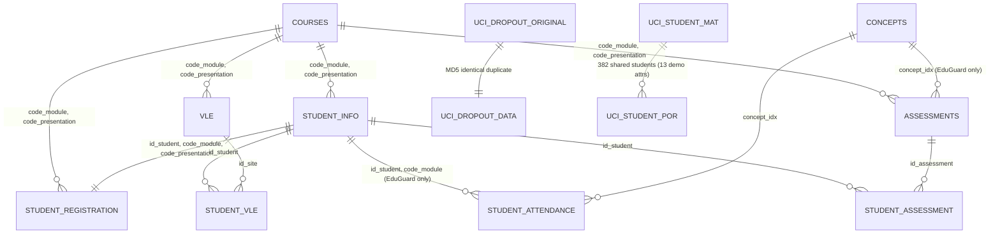
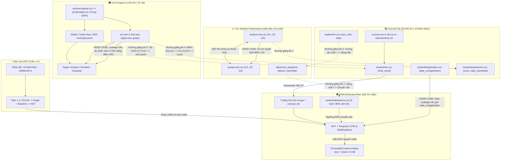

---
tags:
  - master-graph
  - knowledge-graph
  - eduguard
  - mermaid
aliases:
  - Master Knowledge Graph DACN
  - Sơ đồ Đường Giăng Dữ liệu
---

# 🕸️ 00_Master_Graph — Bản đồ Tri thức & Đường giăng Dữ liệu Toàn hệ thống

Tài liệu này tổng hợp toàn bộ **thực thể, khóa ngoại, chuỗi thời gian, đường giăng ẩn (hidden links) và các trường hợp ngoại lệ (edge cases)** giữa 4 bộ dữ liệu mới thu thập tại `C:\DulieuoD\DACN`, 4 báo cáo tiến độ PDF, và hệ thống [[README|GNN-EduGuard]].

---

## 1. Sơ đồ Thực thể & Khóa liên kết (`erDiagram`)

---

## 2. Sơ đồ Toàn bộ Đường giăng & Luồng Ngoại lệ (`graph TD`)

---

## 3. Phân tích Chi tiết Các Đường giăng Ẩn & Edge Cases (Luồng 2)

### 🔗 A. Các đường giăng ẩn (Cross-Dataset Semantic Bridges)
1. **Đường giăng Hành vi Chuyên cần (`absences` ↔ `studentAttendance.csv` ↔ `studentVle.csv`):**
   - Bộ `UCI Student Performance` có biến `absences` (`0–93` buổi), tương đồng ngữ nghĩa trực tiếp với `attended` (`9` buổi) trong `GNN-EduGuard` (`studentAttendance.csv`) và độ giảm sút `sum_click` theo tuần trong `OULAD`.
   - **Ứng dụng:** Cho phép hiệu chuẩn trọng số rủi ro chuyên cần giữa môi trường học trực tiếp (vắng mặt) và LMS trực tuyến (mất tương tác VLE).
2. **Đường giăng Chuỗi thời gian Học lực (`score` theo `date_submitted` ↔ `1st/2nd sem grade` ↔ `G1, G2, G3`):**
   - Cả 3 bộ dữ liệu đều có cấu trúc tiến trình theo thời gian: OULAD theo ngày/tuần (`date`), UCI Dropout theo 2 học kỳ (`1st sem` → `2nd sem`), UCI Performance theo 3 kỳ (`G1` → `G2` → `G3`).
   - **Ứng dụng:** Đồng bộ hóa bài toán *Early Warning* (dự đoán sớm khi chưa có điểm cuối kỳ).
3. **Đường giăng Kinh tế - Xã hội (`Debtor`, `Tuition fees up to date`, `GDP` ↔ `imd_band`):**
   - `GNN-EduGuard` hiện tại chỉ dùng `300` SV từ OULAD (chỉ có `imd_band` — chỉ số thiếu thốn vùng). Bộ `UCI Dropout` bổ sung trực tiếp biến tài chính cá nhân (`Debtor`, `Tuition fees up to date`, `Scholarship holder`) và kinh tế vĩ mô (`Unemployment rate`, `Inflation rate`, `GDP`).
   - **Ứng dụng:** Giải thích các ca bỏ học dù điểm chuyên cần và LMS ban đầu vẫn ổn (dropout do tài chính).
4. **Đường giăng Đa môn học (`382` học sinh trùng trong `student-mat` & `student-por`):**
   - Cho phép mô hình hóa đồ thị đồng học (co-enrollment / multi-subject spillover): học sinh rớt hoặc nghỉ nhiều ở Toán có xu hướng kéo theo giảm điểm ở môn còn lại.

### ⚠️ B. Các Edge Cases & Mâu thuẫn dữ liệu đã phát hiện
1. **Trùng lặp tuyệt đối (`archive.zip` vs `predict+students+dropout...zip`):**
   - `original.csv` và `data.csv` có cùng mã băm `MD5: ee29c9ee9ea60654b5bb0a161c0a473d`. **Tuyệt đối không gộp đôi** khi huấn luyện để tránh nhân đôi tập dữ liệu gây rò rỉ train/test.
2. **Lỗi tên cột & Encoding (`UCI Dropout`):**
   - Cột `'Daytime/evening attendance\t'` chứa ký tự tab thừa ở cuối; cột `'Nacionality'` viết sai chính tả; file dùng delimiter `;` và UTF-8 BOM. Cần chuẩn hóa trước khi đưa vào pipeline.
3. **Nguy cơ Data Leakage (Rò rỉ tương lai):**
   - Trong **OULAD**: `date_unregistration` chỉ có khi sinh viên đã rút môn; `final_result = Withdrawn` gắn chặt với cột này.
   - Trong **UCI Dropout**: Dùng `Curricular units 2nd sem` để dự đoán `Dropout` sẽ cho độ chính xác cao giả tạo nếu mục tiêu là cảnh báo sớm ngay từ HK1.
   - Trong **UCI Student Performance**: `G1`, `G2` tương quan cực mạnh với `G3`. Cần tách 2 kịch bản thực nghiệm ở Bước 4: **Full Features** vs **Early Warning (ẩn G1/G2 hoặc ẩn HK2)**.
4. **Chênh lệch quy mô mẫu (`OULAD Full` vs `EduGuard Raw`):**
   - `OULAD Full` có `32,593` SV (`10.65M` dòng VLE), trong khi `EduGuard Raw` hiện tại chỉ lấy mẫu `300` SV (`2,200` dòng VLE) + sinh thêm `studentAttendance.csv` (`2,700` dòng) theo [[quy-che/quy_dinh_diem_danh_9_buoi]].

---

## 4. Bản đồ Điều hướng Vault
- **Dữ liệu chi tiết:** [[datasets/oulad_dataset]] | [[datasets/uci_dropout_success]] | [[datasets/uci_student_performance]] | [[datasets/eduguard_processed_data]]
- **Tiến độ ĐACN (PDF):** [[bao-cao-tuan/phieu_dang_ky_va_tien_do]]
- **Thực nghiệm ML (Bước 4):** [[ml-experiments/ket_qua_huan_luyen_ml]]
- **Kiến trúc & Quy chế gốc:** [[gnn-ai/mo_hinh_gnn_eduguard]] | [[quy-che/quy_che_canh_bao_hoc_vu]] | [[huong-dan-can-thiep/kich_ban_tu_van_sinh_vien_nguy_co]]

<!-- VECTOR_LINKS_START -->
---
## 🔗 Liên kết Ngữ nghĩa Vector (ChromaDB Semantic Links)
> *Tự động tính toán bởi `ObsidianVaultSync` & `ChromaDB` (768-dim Vector Cosine Similarity) giúp hiển thị mạng lưới liên kết ngữ nghĩa trực tiếp trên **Obsidian Graph View**.*

- [[datasets/oulad_dataset|📊 Bộ dữ liệu OULAD (Open University Learning Analytics Dataset)]] — **Cosine Similarity: `49.1%`** *(Mức độ: Mạnh)*
- [[datasets/uci_student_performance|📈 Bộ dữ liệu UCI Student Performance (`student-mat` & `student-por`)]] — **Cosine Similarity: `43.8%`** *(Mức độ: Liên quan)*
- [[datasets/uci_dropout_success|🎓 Bộ dữ liệu UCI Student Dropout & Academic Success]] — **Cosine Similarity: `29.6%`** *(Mức độ: Liên quan)*
- [[ml-experiments/ket_qua_huan_luyen_ml|🤖 Báo cáo Huấn luyện & Đánh giá Mô hình ML (Bước 4)]] — **Cosine Similarity: `27.9%`** *(Mức độ: Liên quan)*
<!-- VECTOR_LINKS_END -->
